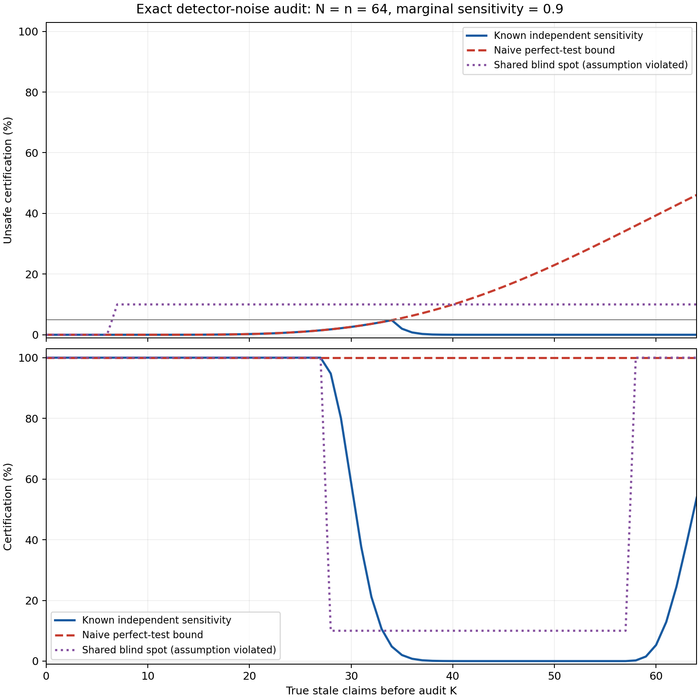
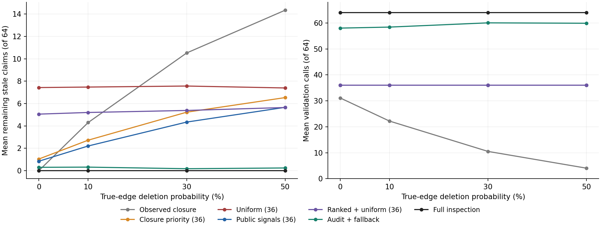
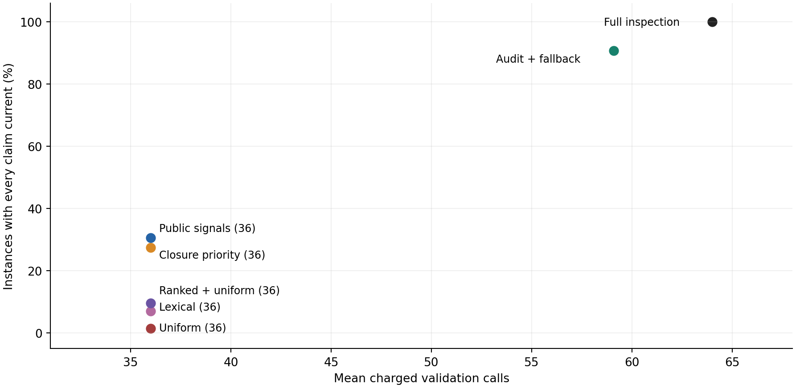

# Auditing Selective Workspace Repair When Provenance Is Incomplete

**Fei Lin · Manor AI · Research preprint v0.1.1 · 14 October 2026**

This repository publishes an English manuscript, executable experiments, formulas, code, figures and complete raw evidence. It is a **synthetic systems research prototype, not a peer-reviewed publication or a deployed Manor feature**. The statistical audit and graph mechanisms are existing techniques, acknowledged in the paper.

## Added in v0.1.1: fallible-detector audit

The original v0.1.0 workspace data/code/results are retained unchanged. This extension computes **3,250 exact parameter-policy scenarios and 68,984 feasible count outcomes**, using hypergeometric sampling with independent false-negative detection. It is an attributed application of existing imperfect-test statistics, **not a new statistical method, real model benchmark or production error-rate estimate**.

- All 1,300 correctly specified independent scenarios have unconditional bound failure and unsafe certification probabilities at most 0.05. Maximum unsafe certification is 0.0481443.
- Assuming perfect checks when actual independent sensitivity is 0.9 can be unsafe even after checking all 64 claims. With all 64 initially stale, the probability of certifying with more than six stale claims remaining is **46.10%**.
- Correct sensitivity does not establish independence. A modeled shared blind spot with marginal sensitivity 0.9 gives **10% unsafe certification** at the same full-census scenario.
- Withholding is a cost: at sample size 16 none of the declared sensitivities permits certification, even when no actual stale claims remain. At size 24, sensitivities 0.7 and 0.5 also never certify.
- Unconditional error control is not correctness conditional on passing. In one calibrated scenario, only 4.814% of audits pass, and every passed audit is unsafe. The paper reports this explicitly.

All risks above are exact operating characteristics of declared probability models. Sensitivities are controlled inputs; no actual LLM judge accuracy was measured. Known sensitivity, no false positives, independent errors, fixed labels and correct isolated patches are substantive assumptions.



A zero-model parser also recovers **18/18** dependency graphs from the original prepared model fixtures because their contracts explicitly bracket target and operand IDs. Only three rule contracts exist. Correct reachability selects 165 claim instances versus 128 actual value changes, giving 37 unnecessary selections and zero omissions. This establishes an explicit-schema baseline; it does not test implicit provenance inference. The prepared model experiment remains unrun. A new bounded check of the configured BYOK route again returned HTTP 502; no alternative provider/model was selected.

Reproduce the added exact sweep (standard library):

```bash
python3 -B -m unittest discover -s extensions/noisy_audit/code -p 'test_*.py'
python3 -B extensions/noisy_audit/code/noisy_audit.py run --protocol extensions/noisy_audit/protocol.json --out-dir extensions/noisy_audit/results_reproduction
```

Ten new implementation checks and the original 19 offline checks pass. Exact sweep primary/replay outputs are byte-identical. Analytical anchors were explored before the source/grid freeze; it is not external preregistration or unseen-data evaluation.

For the explicit parser diagnostic, copy `diagnostics/bracket_baseline/run_bracket_baseline.py` into an empty scratch directory and run it there with `run --prepared /absolute/path/to/pilot_prepared --scorer /absolute/path/to/code/natural_pilot.py`. It writes only within its own scratch directory and refuses to overwrite completed runs.

Generate the added PNG/SVG and inline manuscript tables/plots from the exact CSV with `python3 -B code/update_noise_results.py` (Matplotlib required for exported plots). `code/update_manuscript_results.py` continues to regenerate the original v0.1 results only.

## Original workspace finding

Checking outside an incomplete provenance graph has a real cost. In this frozen experiment, an audit-and-fallback policy uses **59.08** validation calls on average versus **64** for full inspection: a **7.69% reduction** in this idealized call-count model. It falls back to full inspection in **1,187 of 1,440** workspace-condition instances. **Six** selective releases exceed the authored tolerance of six stale claims. These failures are included in the evidence.

| Policy | Mean calls | Mean remaining stale claims | Instances with all claims current |
|---|---:|---:|---:|
| Observed closure, diagnostic | 16.97 | 7.29 | 485/1440 |
| Closure priority, fixed budget | 36.00 | 3.88 | 394/1440 |
| Lexical ranking, fixed budget | 36.00 | 5.59 | 100/1440 |
| Uniform, fixed budget | 36.00 | 7.47 | 20/1440 |
| Public signals, fixed budget | 36.00 | 3.26 | 441/1440 |
| Ranked + uniform, fixed budget | 36.00 | 5.32 | 138/1440 |
| Audit + fallback | 59.08 | 0.26 | 1306/1440 |
| Full inspection, diagnostic | 64.00 | 0.00 | 1440/1440 |

The five fixed-budget policies are matched at 36 checks. Audit + fallback spends more and intentionally permits residual errors. Its 90.69% fully-current frequency is below the ideal full-inspection diagnostic's 100%. It is not a superiority result over full inspection.





## What was actually run

- 360 generated base workspaces, 64 scalar claim blocks each, three parameterized families.
- Four coupled true-edge deletion probabilities per base: 0%, 10%, 30%, 50%. This yields 1,440 conditions, **not 1,440 independent business tasks**.
- Eight policies, 11,520 method-case executions. A complete byte-identical replay adds no independent cases.
- Exact finite-population implementation checks and 19 offline tests, including six checks of the prepared natural-language pilot.
- Two initial small checks through the existing local account's configured BYOK route did not yield a successful completion. The diagnostic retry returned provider HTTP 502. **No successful model benchmark calls are reported.**

The additional `pilot_prepared/` package contains 18 frozen explicit-contract synthetic workspaces with Markdown, CSV and JSON blocks. It is **prepared, not model-evaluated**. No model score is inferred from missing executions. Gold labels are separate from public prompts.

## Read the paper

- [PDF](Manor_AI_Paper_2.pdf)
- [LaTeX source](Manor_AI_Paper_2.tex), with standalone inline vector plots
- [Prior-art and integration evidence](research/)
- [Complete primary results](results_primary/)
- [Byte-identical replay](results_replay/)

The manuscript explains the repair predicate, actual value changes versus graph influence, a known exact hypergeometric count bound, a conditional proof and the limits of its assumptions. The bound is per frozen instance, unconditional over the planned uniform audit. It is not 95% correctness conditional on release, simultaneous corpus coverage, affected-claim recall, or zero-error certification.

## Reproduce

The benchmark and tests use **Python 3.10+ standard library only**. No model credentials, service deployment, database or private Manor code are required.

```bash
python3 -B -m unittest discover -s code -p 'test_*.py'
python3 -B code/benchmark.py sanity
python3 -B code/benchmark.py run --data-dir data --out-dir results_reproduction --split test
```

`results_reproduction` must be a new/empty destination. Compare `result_manifest.json` with the primary manifest, or compare file hashes. Detailed raw traces use deterministic gzip compression; read with Python's `gzip` module or `gzip -dc`.

Regenerate the same frozen data into a separate empty directory:

```bash
python3 -B code/benchmark.py freeze --data-dir data_reproduction
```

The frozen manifest pins protocol, data and exact benchmark code bytes. Changing that code requires a newly identified study; silently regenerating pins would not reproduce this version.

Generate an inspectable before/after workspace example:

```bash
python3 -B code/benchmark.py example --data-dir data --out-dir example_reproduction
```

For plots only, install Matplotlib into your chosen environment, then run:

```bash
python3 -B code/make_figures.py
python3 -B code/update_manuscript_results.py
```

The manuscript compiles with a standard LaTeX installation providing `amsmath`, `amsthm`, `booktabs`, `listings`, `hyperref`, TikZ and pgfplots, or with Tectonic. Its figures are inline and do not require external image files. The released PDF was generated from the same `.tex` source and visually checked.

## Interpretation and limitations

- The validator has exact executable labels and performs ideal isolated reference patches. It does not demonstrate autonomous LLM semantic repair.
- Patches are in-memory generated blocks. Example Markdown exports do not establish production cross-file transactions.
- Protected human notes are preserved structurally for every policy. Semantic conflict resolution was not tested.
- Titles have generator-specific lexical signals. Ranking results do not establish real semantic retrieval quality.
- Costs are charged validator calls. Graph processing, generation, patching, tokens, dollars and latency are not measured by this cost model.
- Snapshot tokens are checked against retained scope identifiers; there is no live source-mutation monitor in this prototype.
- No complete implementation of LEDGER, MemoRepair, BoardroomAI or CodePlan was executed. The paper cites them as prior work, not weakly adapted methods claimed to be original baselines.
- The six-claim tolerance is an authored demonstration parameter, not a validated business safety level.

## Artifact map

`code/benchmark.py` implements the generator, public-only policies, charged validator, known bound, gate and evidence writer. `data/` contains the pre-execution local freeze. `results_primary/` and `results_replay/` include complete compressed traces, CSV, summaries and hashes. `code/natural_pilot.py` prepares and scores the separate, currently unrun model pilot. `research/v01_independent_review.json` preserves original checks; `research/noisy_audit_independent_review.json` records added formula/code/claim checks. `research/package_checks.json` and `MANIFEST.sha256` record this release integrity; the previous checks are retained with a `v01_` prefix.

Publication on GitHub makes this artifact available for inspection; it does not imply journal acceptance, a DOI, or institutional endorsement. AI assistance was used in writing, implementation and review. No private application code, customer data, credentials, account identifiers or prior patent filing materials are included.

## License and citation

The independently authored research **Python code** is MIT licensed; see [LICENSE](LICENSE). The manuscript, figures and generated data are publicly available research materials with copyright retained by Fei Lin; the MIT code grant does not apply to those materials. Cite the versioned release using [CITATION.cff](CITATION.cff).
